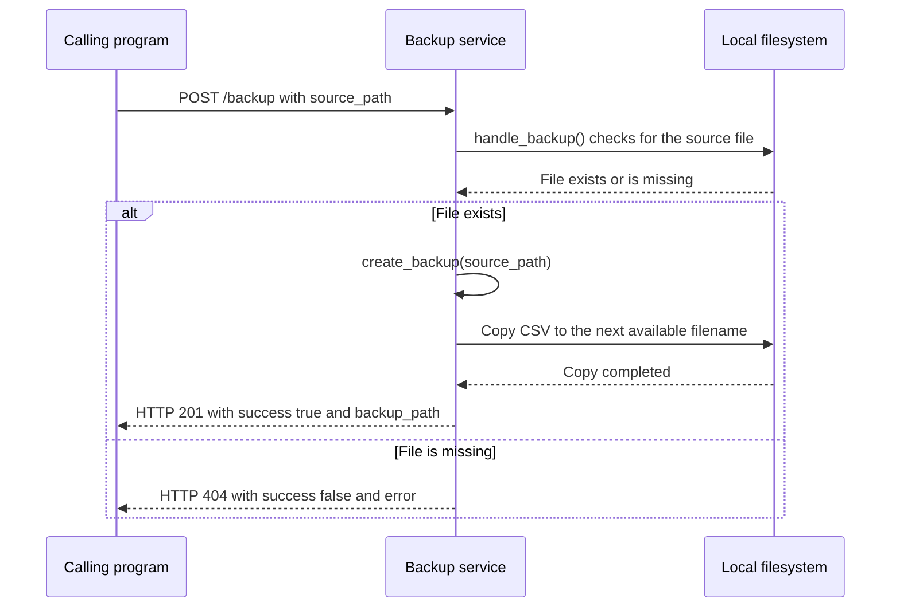

# Sprint 2: Microservice 1 — CSV Backup
11/16/26
The goal for Sprint 2 is to back up a CSV file, keep earlier copies, and report an error if the file is missing. `backup.cpp` handles the file copy and gives each backup its own name. `server.cpp` receives the CSV path over HTTP and returns either the backup path or an error. `test_client.cpp` requests a missing file first, then requests five backups of the same CSV and prints each response.

## Request a backup

Run the caller and the service on the same computer. Send an HTTP POST to `http://127.0.0.1:8362/backup` with the absolute path to the CSV in the JSON field `source_path`. This example uses `sample.csv` from the caller's working directory.

```cpp
httplib::Client client("127.0.0.1", 8362);
nlohmann::json input = {{"source_path", std::filesystem::absolute("sample.csv").string()}};
auto response = client.Post("/backup", input.dump(), "application/json");
```

## Receive the result

Read the JSON body from that same response. HTTP 201 means the backup was created. The `backup_path` field tells you where to find it, for example `backups/sample_1.csv` beside the original. HTTP 404 means the source file was missing. The `error` field names the missing file, and you can send another request without restarting the service.

```cpp
if (response)
{
    auto result = nlohmann::json::parse(response->body);

    if (response->status == 201)
    {
        std::cout << result.at("backup_path").get<std::string>() << '\n';
    }
    else if (response->status == 404)
    {
        std::cout << result.at("error").get<std::string>() << '\n';
    }
}
```

## Sequence diagram


